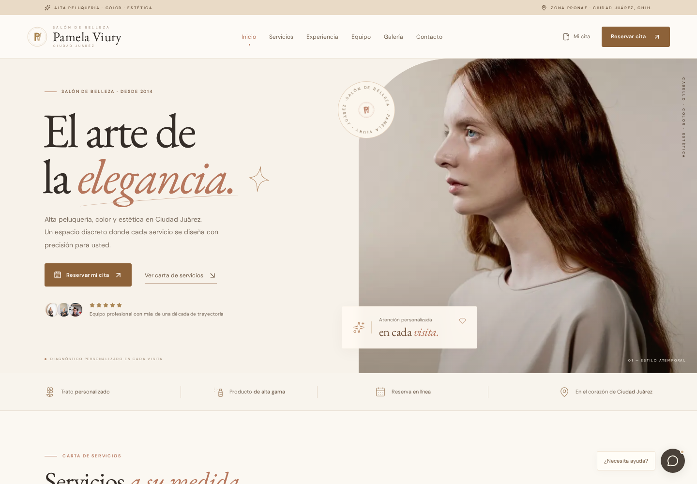

# Salón de Belleza Pamela Viury

Sitio web para un salón de alta peluquería, color y estética en Ciudad Juárez, Chihuahua.
Incluye reserva de citas en línea con folio, comprobantes en PDF y panel de consulta.



---

## Qué incluye

**Para las clientas**
- Reserva de cita en tres pasos: servicio, fecha y hora, datos de contacto.
- Horarios disponibles en tiempo real, sin posibilidad de reservar un hueco ocupado.
- Folio único por cita y comprobante descargable en **PDF** con la imagen del salón.
- Consulta y cancelación de la cita con folio + teléfono.
- Carta de servicios en **PDF de 4 páginas** con portada, tarifas, paquetes y equipo.
- Galería, preguntas frecuentes, formulario de contacto y mapa de ubicación.

**Para el salón**
- Todas las citas y consultas quedan guardadas en PostgreSQL.
- Las reservas simultáneas se bloquean con control de concurrencia en la base de datos.
- Cancelar una cita libera el horario automáticamente.

---

## Tecnologías

| Área | Herramienta |
|---|---|
| Framework | Next.js 16 (App Router) |
| Lenguaje | TypeScript |
| Base de datos | PostgreSQL + Drizzle ORM |
| Estilos | CSS propio + Tailwind |
| PDFs | pdf-lib con tipografías incrustadas |
| Validación | Zod |
| Pruebas | Playwright + pruebas de API |

---

## Instalación

Necesita **Node.js 20 o superior** y **PostgreSQL**.

```bash
# 1. Clonar el proyecto
git clone https://github.com/USUARIO/salon-pamela-viury.git
cd salon-pamela-viury

# 2. Instalar dependencias
npm install

# 3. Configurar la base de datos
cp .env.example .env
#    Abra .env y escriba su cadena de conexión real

# 4. Crear las tablas
npx drizzle-kit push

# 5. Arrancar en modo desarrollo
npm run dev
```

Abra `http://localhost:3000` en el navegador.

### Para producción

```bash
npm run build
npm run start
```

---

## Comandos disponibles

| Comando | Descripción |
|---|---|
| `npm run dev` | Servidor de desarrollo |
| `npm run build` | Compilación de producción |
| `npm run start` | Servidor de producción |
| `npm run lint` | Revisión de código |
| `npm run typecheck` | Comprobación de tipos |
| `node scripts/smoke-test.mjs` | Prueba reservas, folios y PDFs |
| `node scripts/browser-test.mjs` | Prueba la web en escritorio y móvil |

---

## Estructura

```
src/
├─ app/
│  ├─ api/            Reservas, disponibilidad, PDFs y contacto
│  ├─ globals.css     Estilos base
│  ├─ readability.css Ajustes de legibilidad
│  └─ structure.css   Identidad y secciones
├─ components/        Interfaz: reserva, galería, equipo
├─ db/                Esquema de Drizzle
└─ lib/
   ├─ catalog.ts      Servicios, paquetes y equipo
   └─ pdf.ts          Generación de los documentos PDF
```

### Dónde cambiar el contenido

- **Servicios, precios, paquetes y equipo:** `src/lib/catalog.ts`
- **Textos de la página:** `src/components/salon.tsx`
- **Preguntas frecuentes:** `src/components/contact.tsx`
- **Diseño de los PDFs:** `src/lib/pdf.ts`
- **Fotografías:** carpeta `public/images/`

---

## Privacidad

- El archivo `.env` **no se sube** al repositorio: contiene la contraseña de la base de datos.
- No se procesan pagos ni se piden datos bancarios.
- Los comprobantes en PDF requieren un enlace privado con token.
- No se envían correos automáticos.

---

## Aviso sobre el contenido

Este proyecto es una **propuesta de sitio web**. La marca, las fotografías (de
[Pexels](https://www.pexels.com)), los nombres del equipo, los precios, los testimonios y la
dirección son material de referencia y **no corresponden a un negocio verificado**.
Antes de publicarlo, sustituya esos datos por los reales del salón.

---

## Licencia

Uso privado del salón. Las fotografías pertenecen a sus autores bajo la licencia de Pexels.
